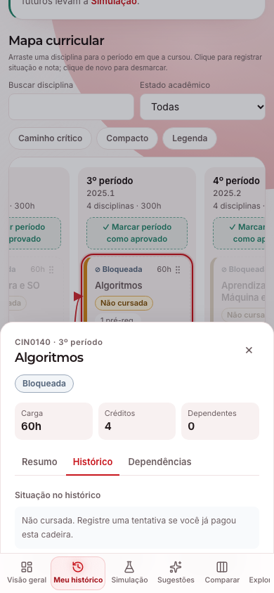
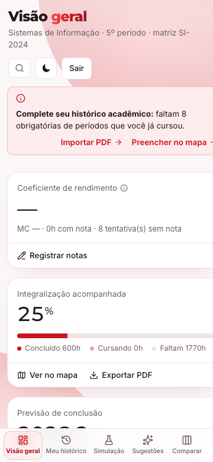
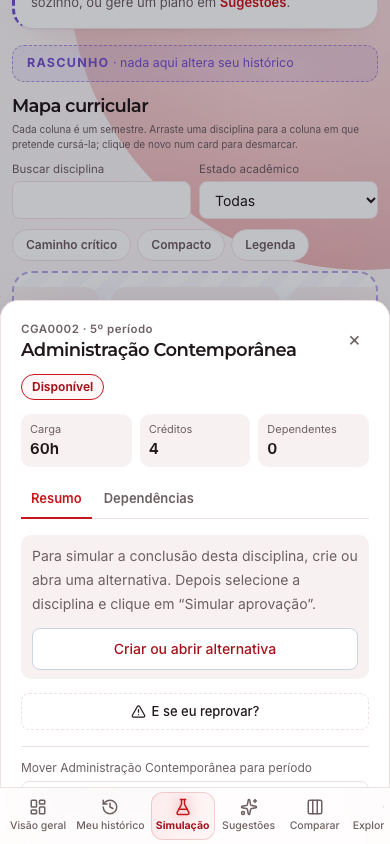
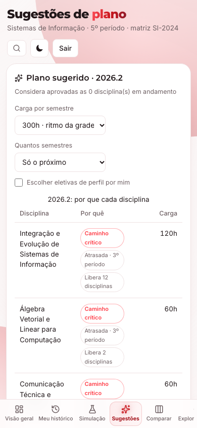
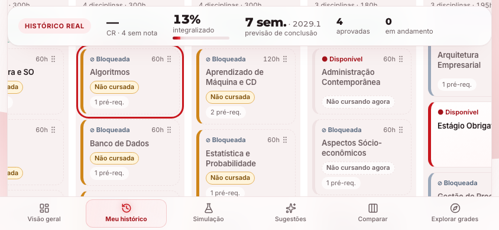

# UX mobile: estudo e aplicação no projeto

Estudo feito em 25/11/2026 sobre o `main` em `e5b4735`. O app rodou com a API de fixtures do Playwright em quatro situações:

- **390×844** (iPhone 14)
- **360×780** (Android de entrada, o tamanho mais comum)
- **844×390** (celular deitado)
- tema escuro

O cadastro de teste usou SI, ingresso em 2024.1 e 5º período, com o 1º e o 2º períodos registrados.

A terceira rodada (seção 4) usou o **build de produção** num Pixel 5 emulado (toque e tela de celular), com dois limites simulados: **4G lento** (1,6 Mbps, 150 ms de latência) e **CPU 4× mais lenta**. É o perfil de "celular intermediário" do Lighthouse. Os efeitos visuais ficaram **ligados**. Isso importa porque a suíte do projeto os desliga quando detecta automação (`navigator.webdriver`, em `frontend/src/fx/motion.ts`), então nenhum teste vê o app como o estudante vê. A rodada incluiu:

- auditoria **axe-core 4.10** (WCAG 2.2 AA e boas práticas) em 11 telas, nos temas claro e escuro
- leitura da tela a 320 px (WCAG 1.4.10, *reflow*)
- escala de texto
- foco e botão Voltar
- gestos de toque reais
- API lenta, API fora do ar e falta de conexão
- toques e rolagem por tarefa

Cada tela também passou por uma medição automática de:

- rolagem horizontal
- alvos de toque menores que 24 e 44 px
- campos com fonte menor que 16 px (o iOS dá zoom ao focar)
- texto menor que 12 px
- elementos fixos

## 1. Princípios que importam para este app

| # | Princípio | De onde vem | O que significa aqui |
|---|---|---|---|
| 1 | **Visibilidade do estado do sistema**: toda ação recebe uma resposta visível e imediata. | Heurística nº 1 de Nielsen | Depois de "Aprovada", o estudante precisa *ver* que funcionou e *onde* a disciplina foi parar. |
| 2 | **A ação principal fica perto do polegar**, na metade de baixo da tela, sem precisar rolar. | Steven Hoober, *How Do Users Really Hold Mobile Devices?* (UXmatters, 2013); Material 3, *bottom sheets* | Na folha de detalhes, a ação vem antes das informações secundárias, não depois. |
| 3 | **Nada fixo cobre conteúdo que se pode tocar.** Barras fixas reservam o próprio espaço. | Material 3, *navigation bar* e *bottom sheet* | A folha de detalhes e a barra de abas não podem se sobrepor. |
| 4 | **Alvos de toque grandes**: 44×44 pt no iOS, 48×48 dp no Android e mínimo de 24×24 px (WCAG 2.2, SC 2.5.8). | Apple HIG; Material 3; WCAG 2.2 | Botões, links de ação e *selects* com pelo menos 44 px de altura. |
| 5 | **Campos com fonte de 16 px ou mais.** Abaixo disso, o Safari do iOS dá zoom ao focar o campo. | Comportamento do Safari no iOS | Todos os `input`, `select` e `textarea`. |
| 6 | **Desfazer em vez de confirmar**: a ação é rápida e um aviso curto oferece "Desfazer". | Heurística nº 3 de Nielsen (controle e liberdade) | Marcar status, mover de período e salvar. |
| 7 | **Revelação progressiva**: mostrar primeiro o essencial e o resto sob demanda. | Nielsen Norman Group | O conteúdo principal de cada tela (mapa, formulário) aparece na primeira tela. |
| 8 | **Contexto explícito**: o usuário sempre sabe *onde* está e *em que* um dado vai cair. | Heurística nº 6 (reconhecer em vez de lembrar) | "2025.1 · 3º período", e não só "2025.1". |
| 9 | **Gestos com alternativa por toque simples.** | WCAG 2.2, SC 2.5.7 (*Dragging Movements*) | Arrastar entre colunas precisa de um equivalente por botão. |
| 10 | **De 3 a 5 destinos na barra inferior**, com rótulos legíveis. | Material 3, *navigation bar* | Hoje são 6, com texto de 10,5 px. |
| 11 | **No toque não existe "passar o mouse".** Informação em `title` ou *tooltip* fica invisível. | Material 3; Apple HIG | Os significados precisam estar no próprio elemento ou num toque. |
| 12 | **Tabelas viram cartões no celular.** | Nielsen Norman Group, *Mobile Tables* | Tabelas com 3 ou mais colunas espremem o texto. |
| 13 | **Texto natural**: plural correto, sem "(s)", e nada de mostrar "0 itens" sem necessidade. | Diretrizes de redação de interface | Avisos e números das telas. |

## 2. Diagnóstico do fluxo "marcar disciplina como concluída"



### P1 (bug): a ação de marcar fica escondida atrás da barra de abas

No celular, os detalhes abrem como folha presa ao rodapé (`.details-popup`, em `frontend/src/styles.css`). A barra de abas também é fixa no rodapé e fica **por cima** dela. Com isso, **+ Aprovada**, **+ Reprovada** e **+ Cursando agora** ficam atrás da barra. Um clique automatizado em "+ Aprovada" **não chegou ao botão**: a barra interceptou o clique até o tempo esgotar.

**Causa confirmada.** A folha tem `z-index: 60` e a barra tem `z-index: 40`. Mesmo assim a barra vence, porque `frontend/src/theme-cin.css` (regra `.shell > .shell-main`, por volta da linha 790) dá `position: relative; z-index: 1` ao conteúdo. Isso cria um contexto de empilhamento: tudo dentro do conteúdo, inclusive a folha, fica no nível 1, abaixo da barra. Um `document.elementFromPoint` no rodapé com a folha aberta devolve a barra.

O mesmo problema acontece na **Simulação**: o campo "Mover … para período" fica sob a barra (veja a seção 3).

### P2: a ação principal está no fim da folha

A ordem atual da folha é esta: código e período, nome, selo de status, três cartões (Carga, Créditos, Dependentes), abas, título, texto explicativo e, **por último**, os botões. O que o estudante veio fazer fica no fim.

### P3: falta resposta depois da ação

O card muda, mas a folha cobre o mapa. Nenhum aviso diz "Algoritmos aprovada em 2025.1 (3º período)" e não há "Desfazer".

### P4 (o "tudo foi para o 1º período"): o semestre padrão é frágil e pouco visível

O mapa do histórico põe a disciplina no período do semestre da tentativa mais recente (`historyLayout` em `frontend/src/academicTerms.ts`). Uma obrigatória registrada num semestre diferente do período da matriz **muda de coluna**. Há dois caminhos que levam ao 1º período sem que o estudante perceba:

- **"Editar histórico" → "Adicionar cadeira"**: cada linha nova começa com `academic_term: startTerm`, ou seja, o semestre de ingresso (`frontend/src/components/HistoryEditor.tsx:378`). Quem adiciona várias cadeiras e só escolhe a disciplina joga todas no 1º período. É o cenário mais provável do relato.
- **"+ Aprovada" na folha**: o semestre padrão é o do período da matriz, mas, se ele já estiver ocupado por outra tentativa, cai em `free[0]`, que é o **primeiro** semestre livre (`frontend/src/components/AttemptsEditor.tsx:52`).

Nos dois casos, o semestre aparece só como "2025.1", sem o período, e nada avisa que o card vai mudar de coluna.

### P5: o mapa em colunas horizontais não funciona bem no celular

Só cabe cerca de 1,5 coluna na tela. O estudante rola na horizontal, perde a referência de qual período está vendo e o mapa disputa a rolagem com a página. "✓ Marcar período como aprovado" só aparece quando se chega à coluna.

### P6: arrastar é o gesto principal, mas é ruim no toque

O arrasto por toque exige pressionar por 180 ms (`TouchSensor` em `frontend/src/components/CurriculumMap.tsx:245`) e disputa com a rolagem. A alternativa "Mover para período" existe, mas fica no fim da folha e, hoje, sob a barra.

### P7: alvos e campos da folha pequenos demais

Os botões "+ Aprovada" e os outros têm 34 px de altura. Os campos de tentativa usam `text-[13px]` (`attempt-field`), então o iOS dá zoom ao focar.

### P8: "Bloqueada" em disciplina do passado confunde

No 5º período, Algoritmos (3º período) aparece como **Bloqueada** antes de os pré-requisitos serem registrados. No modo histórico, a pergunta é "você cursou?", e não "você pode cursar?".

### P9: o primeiro registro é longo

No 5º período são mais de 20 cadeiras, cada uma com abrir folha, marcar e fechar. O caminho em lote ("Marcar período como aprovado") só aparece no cabeçalho de cada coluna.

### P10: a primeira tela do histórico não mostra o mapa

O painel de indicadores, o aviso de histórico vazio, o cartão "Histórico informado" e os filtros ocupam a primeira tela inteira.

## 3. Diagnóstico do app inteiro no celular

### Medição automática (390×844, salvo indicação)

| Tela | Altura da página | Alvos < 24 px | Alvos < 44 px | Campos < 16 px | Texto < 12 px |
|---|---:|---:|---:|---:|---:|
| Login | 1.274 px | 1 | 2 | 2 | 3 |
| Cadastro | 1.684 px | 1 | 7 | **7** | 3 |
| Visão geral | 2.321 px | **9** | 8 | 2 | 6 |
| Meu histórico | **6.398 px** (≈ 8 telas) | 4 | 18 | 3 | **68** |
| Simulação | **6.545 px** | 4 | 19 | 5 | 66 |
| Sugestões | 1.326 px | 2 | 6 | 3 | 13 |
| Comparar | 844 px | 3 | 3 | 0 | 6 |
| Explorar grades | **6.336 px** | 2 | 19 | 5 | 63 |
| Editar histórico | **9.980 px** (≈ 12 telas) | 5 | **61** | **38** | 68 |
| Visão geral, 360 px | 2.341 px, **rola 22 px na horizontal** | 9 | 8 | 2 | 6 |

### P11: no login, o formulário fica abaixo da dobra


A 390×844, a primeira tela é só marca e chamada ("Um novo olhar para o seu futuro"). O campo de e-mail começa no rodapé, e a senha e o botão "Entrar" ficam abaixo da dobra. Quem volta ao app, que é o caso mais frequente, rola **toda vez** para entrar.

### P12: a barra de abas tem 6 destinos e esconde um deles



- A **360 px**, "Explorar grades" fica **totalmente fora** da tela: a barra tem 431 px de conteúdo para 348 px visíveis, sem nenhuma pista de que rola.
- A 390 px, o rótulo aparece cortado ("Explor").
- Os rótulos têm **10,5 px**.
- "Comparar" ocupa um lugar fixo mesmo sem nenhuma alternativa para comparar.

### P13: a Visão geral transborda a 360 px

A página rola 22 px na horizontal, e os cartões (Coeficiente, Integralização, Previsão) aparecem cortados à direita. Rolagem horizontal acidental é uma das falhas mais percebidas no celular.

### P14: links de ação menores que o mínimo da WCAG

Na Visão geral, os links "Importar PDF", "Preencher no mapa", "Registrar notas", "Ver no mapa", "Exportar PDF", "Ver sugestões de plano", "Ver plano completo" e "Ver histórico" têm **20 px de altura**, abaixo do mínimo de 24 px da WCAG 2.2. Também ficam abaixo:

- "Consultar fonte", com 15 px
- "1 aviso(s) sobre os dados", com 18 px
- os botões do topo (busca, tema, Sair), com 32 a 36 px

### P15: "Sair" com destaque no topo de todas as telas

Busca, tema e **Sair** dividem o cabeçalho com o mesmo peso visual. No celular, o polegar passa por ali ao rolar para o topo. Sair por engano custa um novo login, que hoje também exige rolar (P11). Além disso, o espaço do topo vai para ações raras.

### P16: alterações não salvas longe de onde se trabalha

Depois de "Marcar período como aprovado", o aviso "Alterações no histórico ainda não salvas" e o botão **Salvar histórico** aparecem no cartão do topo. Quem está marcando cadeiras no mapa, milhares de pixels abaixo, não vê nem um nem outro. O risco é sair da tela achando que salvou.

### P17: telas longas, com o conteúdo principal abaixo da dobra

- **Histórico** e **Simulação** têm cerca de 6.500 px.
- Na Simulação, o painel "Alternativas" (seletor, nome, "Criar alternativa" e explicação) ocupa a primeira tela inteira, e o mapa só aparece depois.
- Em **Explorar grades**, a lista dos 4 cursos e os filtros ocupam a primeira tela.
- O texto miúdo de ajuda ("Arraste uma disciplina…") repete em todas as telas com mapa, com 11 a 12 px.

### P18: "Editar histórico" é um formulário de 12 telas

A tela tem cerca de 10.000 px, **61 alvos menores que 44 px** e **38 campos menores que 16 px**: cada um dá zoom no iOS. Cada tentativa vira um bloco empilhado de Disciplina, Semestre, Situação e Nota. Os campos "Semestre de ingresso" e "Período atual" repetem o que já está no cadastro. Combinado com o padrão de semestre do P4, é o caminho mais propenso a erro do app.

### P19: a folha de detalhes da Simulação também fica sob a barra



A causa é a mesma do P1. O campo "Mover … para período" fica atrás da barra de abas.

### P20: Sugestões usa uma tabela de 3 colunas no celular



O nome da disciplina quebra em até 4 linhas e os motivos ("Caminho crítico", "Atrasada · 3º período", "Libera 12 disciplinas") se empilham numa coluna estreita. Também aparece "Considera aprovadas as **0 disciplina(s)** em andamento", mesmo quando não há nenhuma.

### P21: dois ou três status por card, com nomes parecidos

O mesmo card mostra o selo do topo ("⊘ Bloqueada" ou "● Disponível") **e** um chip embaixo ("Não cursada" ou "Não cursando agora"). "Não cursada" e "Não cursando agora" querem dizer coisas diferentes (`frontend/src/components/CourseCard.tsx:217` e `:235`), mas é difícil distinguir isso numa leitura rápida.

### P22: informação que só existe ao passar o mouse

O ponto vermelho de disciplina **crítica** explica o que é apenas em `title` e `aria-label` (`CourseCard.tsx:265`). No toque, quem enxerga vê um ponto sem significado, a menos que abra a legenda.

### P23: com o celular deitado, sobra pouca tela



A 844×390, a barra fixa de indicadores (cerca de 80 px) e a barra de abas (cerca de 55 px) ocupam **cerca de 35% da altura**. Sobram uns 250 px para o mapa.

### P24: textos com "(s)"

"tentativa(s) sem nota" e "semestre(s) restante(s)" (`frontend/src/pages/Overview.tsx:268` e `:312`), "aviso(s) sobre os dados" (`frontend/src/Student.tsx:1127`) e "disciplina(s)" (`frontend/src/pages/Suggestions.tsx:91`). No celular, cada palavra a mais pesa.

### P25: Explorar grades ignora o perfil de quem está logado

Logado como aluno do 5º período com ingresso em 2024.1, o Explorar abre em "1º período" e "2025.1". Ele poderia começar no curso, período e ingresso do perfil, deixando a troca como opção.

### O que já funciona bem (manter)

- **Estados vazios claros.** A Visão geral sem histórico oferece duas saídas bem explicadas: importar o PDF ou preencher no mapa. O Comparar sem alternativas diz exatamente o que falta.
- **Modal de importação do PDF.** São 3 passos numerados, uma área grande de toque e um aviso de privacidade. É o melhor fluxo do app no celular.
- **Tema escuro** legível, com bom contraste.
- **"Marcar período como aprovado"**, uma ação em lote certeira para o caso mais comum.
- **Folha de baixo para cima** no celular: o padrão está certo e só falha na camada (P1) e na ordem do conteúdo (P2).

## 4. Análise aprofundada: acessibilidade, desempenho, comportamento e esforço

### Resumo da auditoria de acessibilidade (axe-core, tema claro)

| Tela | Crítico | Sério (contraste) | Moderado |
|---|---|---|---|
| Visão geral | busca sem nome | — | sem `main`, conteúdo fora de regiões |
| Meu histórico | busca sem nome | 4 | sem `main`, 4 regiões |
| Histórico com folha aberta | busca sem nome | **94** | sem `main`, 4 regiões |
| Simulação | busca sem nome | 4 | sem `main` |
| Sugestões | busca sem nome | 3 | sem `main` |
| Explorar grades | — | 3 | sem `main`, 7 regiões |
| Editar histórico | busca sem nome | 4 | sem `main` |
| Login e cadastro | — | — | — |

No **tema escuro** não houve nenhuma falha de contraste. A 320 px de largura, login, Visão geral, Histórico, Sugestões e Simulação **não rolam na horizontal** (no estado sem histórico). Isso atende a WCAG 1.4.10. O transbordo do P13 aparece com o histórico parcialmente preenchido.

### P26 (crítico): o botão de busca não tem nome para leitores de tela

No celular, o texto "Buscar" do botão `.search-trigger` (`frontend/src/components/AppShell.tsx:178`) fica escondido e sobra só o ícone. O TalkBack e o VoiceOver anunciam apenas "botão". A falha aparece em todas as telas logadas.

### P27: não existe região principal (`main`)

O conteúdo fica num `div.shell-main` (`AppShell.tsx:167`). Quem usa leitor de tela não consegue pular direto para o conteúdo, e avisos e barras de ferramentas ficam fora de qualquer região.

### P28: contraste insuficiente no tema claro

- **Botões da barra do mapa** (`.chip-group`): `#7b8ca0` sobre branco dá **3,39:1** em 12 px. O mínimo é 4,5:1.
- **Títulos dos cartões de resumo** (`.summary-card h2 span`): `#6a8098` dá **4,07:1** em 13 px.
- **Motivos nas Sugestões** ("Caminho crítico"): `#ff3b45` dá **3,52:1** em 11 px.
- **Cards esmaecidos** quando uma disciplina está selecionada (`opacity: 0.32`, `frontend/src/styles.css:1371`): são 94 elementos, com contraste de até **1,54:1**. O esmaecimento é proposital, mas o texto continua ali e fica ilegível.

### P29: a folha de detalhes não é um diálogo para quem não enxerga

A folha é um `<aside>` sem `role="dialog"` nem `aria-modal`. Ao abrir, o foco **continua no card**. Em 12 toques de Tab, o foco **nunca entrou na folha**, porque ela vem depois de todos os cards no DOM. Com o TalkBack ou o VoiceOver, a folha aparece sem ser anunciada, e chegar até ela exige percorrer o mapa inteiro.

### P30: o modal de importação não leva o foco para dentro

O modal tem `role="dialog"` e `aria-modal="true"`, o que está correto. Mas, ao abrir, o foco fica no botão que o abriu, atrás do modal.

### P31: o texto não acompanha a preferência de tamanho de fonte

Ao dobrar o tamanho de fonte da raiz, **só 25% dos textos** (146 de 581) crescem. O resto usa tamanhos fixos em px (`text-[13px]`, 10,5 px, 11 px…). Navegadores que aumentam a fonte padrão, como Firefox para Android e Samsung Internet, não conseguem ajudar quem precisa de letra maior (WCAG 1.4.4).

### P32: o 3D do login ocupa o processador do celular

- **Peso.** O login baixa cerca de **607 KB** comprimidos. Desse total, **241 KB** (40%) são o pacote do símbolo 3D (three.js, em `frontend/src/fx/CinSymbol3D.tsx`) e **100 KB** são o brasão em PNG (`frontend/public/brand/ufpe-brasao.png`, que poderia ser SVG ou WebP com menos de 15 KB).
- **Tempos.** O primeiro conteúdo aparece em **2,4 s** e o maior elemento em **3,0 s**, o que é aceitável.
- **Processador.** Nos primeiros ~16 s, o celular simulado teve **77 tarefas longas, que somam ~9,9 s** além do limite de 50 ms. O `<Canvas>` usa o *loop* padrão (redesenha sem parar) com `dpr` de até 2. O símbolo gira enquanto a pessoa digita e-mail e senha, e cada tecla disputa o processador com o 3D. O efeito também gasta bateria.

### P33: o app demora a responder ao toque em celular intermediário

Com a CPU 4× mais lenta, os tempos aproximados (incluindo a sondagem do teste) foram:

| Ação | Tempo |
|---|---|
| Tocar num card até a folha aparecer | **~1,85 s** |
| "Marcar período como aprovado" | **~1,7 s** |
| Salvar o histórico (com rede) | ~1,5 s |
| Do "Cadastrar" à Visão geral (com a cortina de 0,9 s) | ~2,7 s |

A referência de "boa" resposta (INP) é até 200 ms. Acima de 500 ms é considerada **ruim**. A suspeita é que cada seleção recalcule e redesenhe toda a tela `Student.tsx` (cerca de 1.700 linhas, mapa com dezenas de cards e setas em SVG). Isso precisa ser confirmado com o React Profiler.

### P34: abertura e cortina a cada sessão

A abertura dura 2,8 s mais 0,65 s de saída e aparece a cada **sessão nova** (`sessionStorage`). Ao entrar, ainda passa uma cortina de 0,9 s. No celular, abrir o link de novo numa aba nova já é uma sessão nova. O aviso diz "Clique para pular", mas no celular se toca. E como a suíte desliga esses efeitos, nenhum teste mede esse custo.

### P35: carregamento sem esqueleto

Com a API levando 4 s para responder, a tela inteira fica em **"Carregando sessão…"**: nenhuma estrutura aparece, nem barra de abas nem título. O app já usa TanStack Query, mas não guarda os últimos dados para mostrar na hora.

### P36: o botão Voltar do Android não fecha a folha nem o modal

Com a folha de detalhes aberta, **Voltar saiu da página**: de `/historico` para a página anterior. Com o modal de importação aconteceu o mesmo. No Android, quem toca Voltar espera fechar o que está por cima.

### P37: a API fora do ar parece logout

Com a API inacessível, abrir Sugestões ou recarregar a página mostra **a tela de login**, com "Não foi possível conectar ao sistema". O estudante acha que foi deslogado e tenta digitar a senha de novo. "Sem conexão" e "sessão expirada" precisam de tratamentos diferentes.

**Funciona bem:** salvar sem conexão mostra "Não foi possível conectar ao sistema. Verifique a conexão e tente novamente." e **mantém as alterações pendentes**, com o botão Salvar ainda disponível.

### P38: o app não pode ser instalado

Não há `manifest`, ícone para a tela inicial (`apple-touch-icon`) nem *service worker*. O `theme-color` existe. Para uma ferramenta que o estudante consulta todo semestre, um atalho na tela inicial com nome e ícone próprios e a última consulta disponível sem rede valem a pena.

### P39: teclado virtual e textos de interface

- **"Matrícula"** não tem `inputmode="numeric"`, embora a matrícula de exemplo do README seja numérica (`20260001`). **"Semestre de ingresso"** (`AAAA.1`) não tem `inputmode="decimal"`. Os dois abrem o teclado completo.
- **Risco não medível no emulador:** no iOS, o teclado não encolhe a área da página. O campo de nota na folha presa ao rodapé tende a ficar **atrás do teclado**. O mesmo vale para os campos no fim da folha.
- **Textos de desktop no celular:** "Clique para registrar…", "Clique em Salvar para **persistir**" (`frontend/src/Student.tsx:382`, `:390`, `:494`) e "Clique para pular". No celular é "toque", e "persistir" é jargão de programação.

### P40: esforço por tarefa (Pixel 5)

| Tarefa | Toques | Rolagem vertical | Rolagem horizontal | Observação |
|---|---:|---:|---:|---|
| Registrar do 1º ao 4º período como aprovados e salvar | 5 | 46 px | **343 px** | É preciso caçar as colunas na horizontal. |
| Marcar uma disciplina do 5º período como "cursando" e salvar | 3 | **536 px** | 292 px | O toque em "+ Cursando agora" **cai na barra de abas** (`elementFromPoint` = barra, y = 796). |

**Funciona bem:** arrastar o dedo na vertical **sobre um card** rola a página normalmente (299 de 300 px), e na horizontal rola o mapa. O arrasto com espera de 180 ms **não atrapalha a rolagem**.

## 5. Propostas: como aplicar

Estão em ordem de prioridade. As três primeiras resolvem o relato direto do estudante.

### A. Folha de detalhes que respeita a barra e põe a ação primeiro (P1, P2, P7, P19)

- **Corrigir a camada.** Renderizar a folha num *portal* em `document.body` (`createPortal`), fora do `.shell-main`. Assim ela sai do contexto de empilhamento de `z-index: 1`. Como alternativa só de CSS, esconder a barra de abas enquanto a folha estiver aberta no celular (`.shell:has(.details-popup:not(.hidden)) .sidebar { display: none }`). Isso corrige Histórico, Simulação e Explorar ao mesmo tempo.
- **Barra de ação no topo da folha**, logo abaixo do nome: um controle segmentado **Aprovada · Reprovada · Cursando · Não cursada**, com 44 px de altura e toque único, e ao lado o *chip* de semestre (seção B).
- **Nota opcional** logo abaixo, que só aparece depois de escolher Aprovada ou Reprovada.
- Carga, Créditos e Dependentes vão para a aba "Resumo". "Mover para período" vira um botão visível.
- Fonte de 16 px nos campos.

```
┌──────────────────────────────────┐
│ CIN0140 · 3º período          ×  │
│ Algoritmos                       │
│ [Aprovada][Reprovada][Cursando]  │  ← 1 toque
│ Semestre: 2025.1 · 3º período ▾  │  ← sempre com o período
│ Nota (opcional): [      ]        │
│ ───── Resumo · Dependências ──── │
└──────────────────────────────────┘
```

### B. Semestre sempre explícito e padrão confiável (P4, P18)

- Exibir **"2025.1 · 3º período"** em todo lugar onde aparece semestre. `periodOf` já existe em `academicTerms.ts`.
- **Padrão do semestre**: o período da matriz para obrigatórias e o último semestre usado para eletivas. Se estiver ocupado, usar o semestre livre **mais próximo** dele, e não o primeiro (`AttemptsEditor.tsx:52`).
- **"Adicionar cadeira"**: a linha nova herda o semestre da linha anterior. Ao escolher a disciplina, o semestre vira o do período da matriz (`HistoryEditor.tsx:378`).
- **Aviso de mudança de coluna**: se o semestre não for o da matriz, mostrar "Vai aparecer na coluna do 1º período (2024.1)".

### C. Resposta imediata, "Desfazer" e salvar sempre à vista (P3, P16)

- Aviso curto acima da barra de abas: **"Algoritmos aprovada em 2025.1 (3º período) · Desfazer"**. `setNotice` já existe em `Student.tsx`.
- **Barra de salvar fixa** enquanto houver alterações pendentes, logo acima da barra de abas: "3 alterações · Descartar · **Salvar**". Ela substitui o aviso que hoje fica só no cartão do topo.
- Pulsar o card alterado e rolar até ele ao fechar a folha. `scrollTo` já existe.

### D. Navegação e cabeçalho (P11, P12, P15, P13)

- **Barra de abas com 5 destinos**: Visão geral, Histórico, Simulação, Sugestões e **Mais**. "Mais" abre uma folha com Comparar, Explorar grades, Importar PDF, tema, Exportar PDF e Sair. Rótulos com pelo menos 12 px, sem cortes.
- **Cabeçalho enxuto**: título e um botão de busca. "Sair" e tema vão para "Mais" (ou para um menu de conta).
- **Login com o formulário primeiro** no celular: logo e título numa faixa curta, formulário logo abaixo, chamada e ilustração depois. Usar `autocomplete="email"` e `autocomplete="current-password"`.
- Corrigir o transbordo horizontal da Visão geral a 360 px. Testar sempre em 360 px, não só em 390.

### E. Mapa por período no celular (P5, P6, P10, P17, P23)

- Abaixo de 900 px, trocar as colunas horizontais por **uma faixa fixa de períodos** (`1º 2º 3º …`, com o atual em destaque) e **um período por vez**, em lista vertical.
- "✓ Marcar período como aprovado" no topo de cada período, sempre visível.
- Recolher os blocos de topo (indicadores, "Histórico informado", painel "Alternativas", lista de cursos do Explorar) num resumo de uma linha que abre sob demanda. O mapa precisa aparecer na primeira tela.
- Com o celular deitado ou ao rolar para baixo, esconder a barra fixa de indicadores. Ela volta ao rolar para cima.

### F. Assistente de primeiro registro (P9)

Para quem entra no 3º período ou depois e ainda não tem histórico, oferecer: *"Vamos registrar o que você já cursou, período a período."* Cada passo mostra um semestre ("1º período · 2024.1") com as obrigatórias **já marcadas como aprovadas**, e o estudante só ajusta as exceções. A importação do PDF continua como caminho principal.

### G. "Editar histórico" no celular (P18)

- Agrupar por semestre ("2024.1 · 1º período"), com "+ Adicionar cadeira neste semestre". O semestre fica implícito e o erro do P4 deixa de existir.
- Cada tentativa vira uma linha compacta: nome, situação e nota. Tocar nela abre a mesma folha de detalhes da seção A.
- Remover "Semestre de ingresso" e "Período atual" daqui, ou recolher em "Dados do curso".

### H. Conteúdo, rótulos e alvos (P8, P14, P20, P21, P22, P24, P25)

- **Sugestões em cartões**: nome em uma linha, carga à direita e motivos como chips abaixo. Esconder "0 disciplinas em andamento".
- **Um status por card**, conforme o contexto: no histórico, "Aprovada", "Reprovada", "Cursando" ou "Não registrada". Trocar "Não cursando agora" por algo como "Fora do plano".
- **Crítica com rótulo visível**, por exemplo um chip "Crítica" ou um ícone com legenda fixa, em vez de um ponto explicado só no `title`.
- **Links de ação com 44 px de área de toque** (padding vertical, sem mudar o visual).
- **Plurais corretos** com uma função `plural(n, "tentativa", "tentativas")` ou `Intl.PluralRules`.
- **Explorar** começa no curso, período e ingresso do perfil quando há login.
- **Textos de celular**: trocar "Clique" por "Toque" ou por verbos neutros ("Selecione"), e "persistir" por "guardar". Esses textos ficam em `Student.tsx` e em `Effects.tsx`.

### I. Acessibilidade (P26 a P31)

- `aria-label="Buscar"` no `.search-trigger`. É uma linha e corrige o único erro crítico.
- Trocar `div.shell-main` por `<main>` e pôr avisos e barras dentro das regiões.
- **Folha de detalhes como diálogo**: `role="dialog"`, `aria-modal="true"` e `aria-labelledby` apontando para o nome da disciplina. Ao abrir, o foco vai para o título ou para a primeira ação, fica preso na folha e volta ao card ao fechar. Com o *portal* da seção A, a folha também fica no fim do `body`, perto do foco. O mesmo foco inicial vale para o modal de importação.
- **Contraste**: escurecer `#7b8ca0` e `#6a8098` para pelo menos `#5b6b7d` em fundo branco (5,46:1), e o vermelho dos motivos para algo como `#c8161d`, o vermelho da marca (5,85:1). Nos cards esmaecidos, usar `opacity` de pelo menos 0,55 ou esmaecer só o fundo e a borda, não o texto.
- **Fontes em `rem`**: migrar `text-[13px]`, 10,5 px e similares para a escala `rem` do Tailwind (`text-xs`, `text-sm`). O texto passa a acompanhar a preferência de quem lê.
- Rodar o axe-core na suíte (`@axe-core/playwright`), falhando o teste em erros críticos e sérios.

### J. Desempenho (P32 a P35)

- **3D sob medida**: no celular (`pointer: coarse` ou largura abaixo de 900 px), mostrar o símbolo estático (SVG ou WebP) e carregar o 3D só no computador. Quando o 3D rodar, usar `frameloop="demand"` ou pausar quando o canvas sai da tela ou a aba fica oculta (`IntersectionObserver` e `visibilitychange`), com `dpr={[1, 1.5]}`.
- **Brasão** em SVG ou WebP, saindo de 100 KB para menos de 15 KB.
- **Abertura uma vez por aparelho**, guardada em `localStorage` e não em `sessionStorage`, e "Toque para pular" no celular. A cortina ao entrar só no primeiro login.
- **Resposta ao toque**: medir com o React Profiler, aplicar `React.memo` no `CourseCard`, memoizar layout e setas por seleção e usar `content-visibility: auto` nas colunas fora da tela. **Meta: folha aberta em até 200 ms** com CPU 4× mais lenta.
- **Esqueleto e cache**: mostrar a estrutura (barra de abas, título, cartões vazios) enquanto a sessão carrega. Persistir o cache do TanStack Query (`persistQueryClient` com `localStorage`) para exibir os últimos dados na hora.
- Um teste de Playwright com os efeitos **ligados** e a CPU limitada, para medir o que o estudante vê de fato.

### K. Comportamento de app (P36 a P39)

- **Voltar fecha o que está por cima**: abrir a folha ou o modal empurra uma entrada no histórico do navegador, por exemplo `?disciplina=alg`. Voltar fecha a folha, e a disciplina aberta vira um link que pode ser compartilhado.
- **Sem conexão não é logout**: manter a tela, mostrar uma faixa "Sem conexão. Mostrando os últimos dados." com **Tentar de novo**, e só ir ao login em resposta 401.
- **App instalável**: `manifest.webmanifest` com nome, ícones e `display: standalone`, mais `apple-touch-icon`. Um *service worker* simples (por exemplo, `vite-plugin-pwa`) guarda os arquivos do app e a última consulta.
- **Teclado**: `inputmode="numeric"` na matrícula, `inputmode="decimal"` no semestre e `enterkeyhint="next"` ou `"done"` nos formulários. Na folha, ajustar a altura pelo `visualViewport` quando o teclado abrir.

## 6. Ordem sugerida

| Ordem | Bloco | Por quê |
|---|---|---|
| 1 | **A + B + C**, com a parte de diálogo da **I** | Corrigem o bug de toque, a ação escondida, o semestre errado e o salvar invisível. A folha já nasce como diálogo acessível e fecha com Voltar (**K**). São mudanças localizadas em `theme-cin.css`, `styles.css`, `CourseDetails.tsx`, `AttemptsEditor.tsx`, `HistoryEditor.tsx` e `Student.tsx`. |
| 2 | **I** (o resto) e **J** (3D, brasão e abertura) | Rótulo da busca, `<main>`, contraste e o 3D fora do celular são mudanças pequenas com grande efeito. |
| 3 | **D** | A navegação perde um destino a 360 px e o login exige rolar. Essas mudanças afetam todas as telas. |
| 4 | **K** (sem conexão, teclado) e **H** | Ajustes independentes, que podem ser feitos em paralelo. |
| 5 | **J** (resposta ao toque, esqueleto e cache) | Pede medição com o Profiler antes de mexer. |
| 6 | **F + G** | São o maior ganho no primeiro uso e no caminho mais propenso a erro. |
| 7 | **E**, e o app instalável da **K** | São as mudanças estruturais. Pedem mais testes. |

Cada bloco deve ganhar testes de Playwright em **360×780** e **390×844**. Quatro verificações automáticas cobrem quase toda a classe de problemas deste estudo:

1. Nenhuma página rola na horizontal.
2. Nenhum alvo de toque é menor que 24 px.
3. Nenhum campo tem fonte menor que 16 px.
4. Com a folha aberta, `elementFromPoint` no rodapé cai dentro da folha.

Elas podem virar um único `mobile-audit.spec.ts`, junto com o axe-core (nenhum erro crítico ou sério), o foco dentro da folha ao abrir, Voltar fechando a folha e um teste de tempo de resposta com a CPU limitada.
